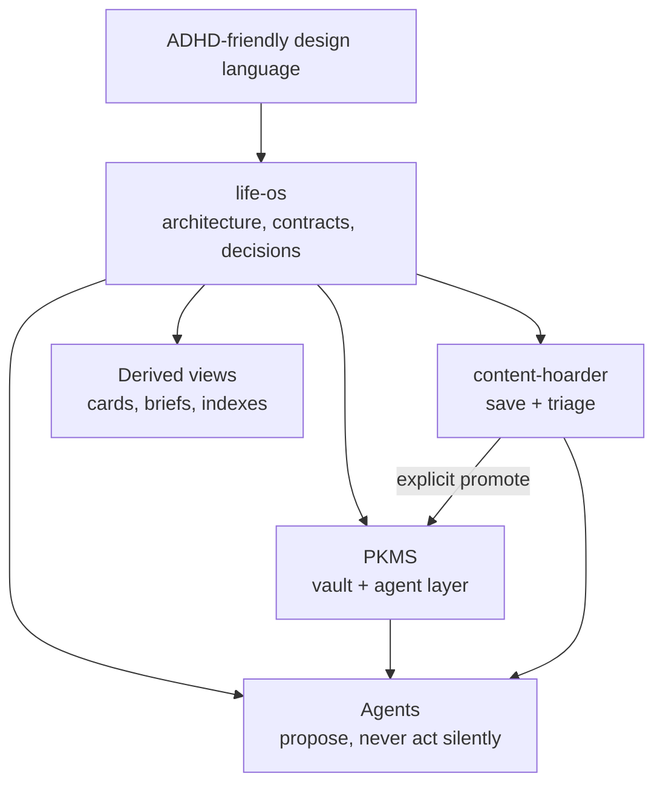

# life-os

**The architecture and decision layer for a personal operating system.**

life-os is where the three parts of **Khaos** are designed to work together:

| Project | Role | Where it runs |
|---|---|---|
| [PKMS](https://github.com/asmartin-ai/pkms) | The knowledge vault and the agent layer. Capture, today, search, tasks, reading. | Local or self-hosted; the public product direction. |
| [content-hoarder](https://github.com/asmartin-ai/content-hoarder) | Save-everything inbox and the triage surface for external content. | Local desktop app. |
| life-os (this repo) | Cross-system architecture, shared contracts, decision records, and re-entry design. | Documentation only. |

The problem it attacks: a personal system with a dozen capture surfaces and a dozen tools turns into a second job. life-os keeps the pieces cooperating through one capture contract, one provenance model, one permission model, and one written record per architectural choice — so each tool can stay small and replaceable.

This repository is **documentation only**. There is no application to run, no build step, and no fixtures. The implementations live in the private canonical workspace and the project repos above.

## System shape

Markdown is canonical. Apps, indexes, dashboards, and agents are derived layers: they may read, index, summarize, and render these files, but the truth stays in plain text.

## Current state (November 2026, per the decision records and roadmap)

- **Live capture:** a Google Keep ramp (10-minute timer, deterministic routing that learns from what is kept or dismissed) and a WhatsApp ramp (paired 2026-10-17).
- **Deliberately off since 2026-10-17:** the Gmail ramp and the LLM router stage; routing runs on deterministic rules only.
- **Deployment:** decision 0037 moves the Khaos home to a small Debian VPS — vault, ledger, index, and secrets on the box, with the desktop and phone as clients. Secrets use systemd encrypted credentials; off-site backup is still deferred.
- **Contracts:** thirteen shared object contracts are defined (`capture`, `source_span`, `commitment`, `resurface_card`, `action_envelope`, `action_receipt`, `capability_grant`, and others). They are the actual integration surface between the projects.
- **Modules:** the desk/closure, decision-support, learning, and car-capture modules are a written proposal, not shipped code.
- **Product direction:** PKMS is the public product (self-hosted or managed hosting), built on local plain files, AI-native with full opt-out. See `CONTEXT.md` for the resolved product vocabulary.

## Read in this order

1. [`docs/charter.md`](docs/charter.md) — mission, non-goals, operating principles.
2. [`docs/architecture.md`](docs/architecture.md) — the system map, runtime, and cross-system flows.
3. [`docs/contracts.md`](docs/contracts.md) — the shared objects every module exchanges.
4. [`docs/onramps.md`](docs/onramps.md) — the capture ramps and their one-inbox contract.
5. [`docs/modules.md`](docs/modules.md) — the current module proposal.
6. [`docs/roadmap.md`](docs/roadmap.md) — what runs today, what is off, what is next.
7. [`decisions/`](decisions/) — the architecture decision records.

Supporting material: [`GLOSSARY.md`](GLOSSARY.md) for the shared vocabulary, [`docs/design-takeaways.md`](docs/design-takeaways.md) for the design rules applied here, [`docs/research-takeaways.md`](docs/research-takeaways.md) for the research that shaped the contracts, and [`docs/re-entry-copy.md`](docs/re-entry-copy.md) for the re-entry surface copy.

## What lives here

| Path | Purpose |
|---|---|
| `decisions/` | Architecture decision records, one file per decision. |
| `docs/` | Charter, architecture, contracts, onramps, modules, roadmap, design and research takeaways, publication policy. |
| `templates/` | Markdown templates for new decisions, domain briefs, and re-entry notes. |
| `CONTEXT.md` | Resolved product vocabulary: who the product serves and how it earns money. |
| `GLOSSARY.md` | One word, one meaning across PKMS, content-hoarder, and life-os. |

## About this repository

This is the **public mirror** of a private canonical workspace. It is generated from a reviewed allowlist, not by pushing the private tree:

- Life-domain briefs (`domains/`), source maps, prompts, dated research and session notes, inbox captures, and logs are private by default and are not published.
- Personal paths are genericized to `/path/to/…`, and the owner is referred to generically.
- Documents may still refer to files that exist only in the private workspace (`inbox/`, `logs/`, `domains/`, `docs/research/`); those references are intentional and point at work that is not part of this mirror.
- The mirror is documentation only: history contains no application code, fixtures, archives, or databases.
- The exact allowlist, denylist, and validation commands are in [`docs/publication-safety.md`](docs/publication-safety.md).

## Design position

- Capture is zero-decision and faster than filing.
- One next action beats a complete plan.
- Every surfaced item carries a visible reason and a source.
- Agents observe and propose; side effects follow observe → propose → approve → execute → receipt, with scoped capability grants (ADR 0009).
- Re-entry after a lapse is a first-class flow, never a guilt surface.
- Engagement mechanics, including streaks, are opt-in, measured, and switched off automatically when they add friction (ADR 0035). Raw backlog counts and overdue counters never appear as primary UI.

## License

MIT — see [`LICENSE`](LICENSE). Architecture notes, research, and decision records are provided as-is for reference.
