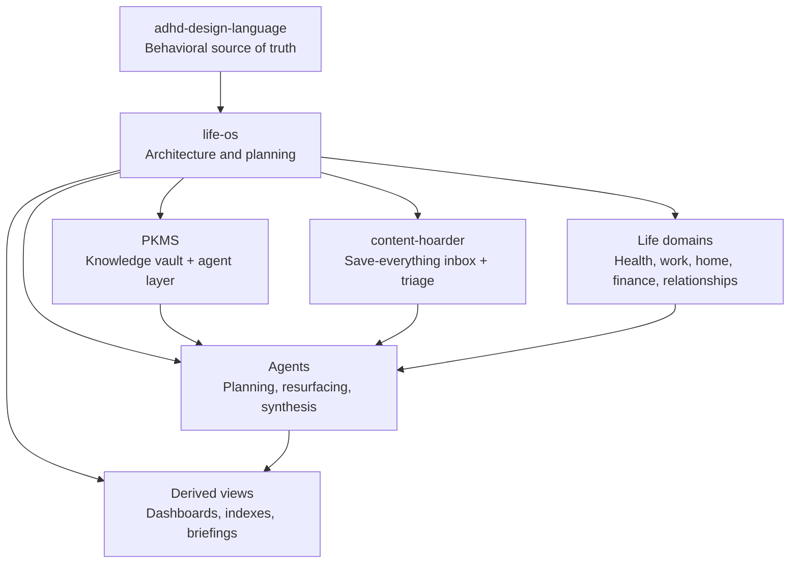
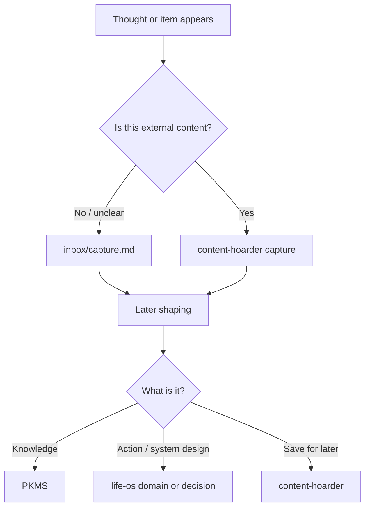
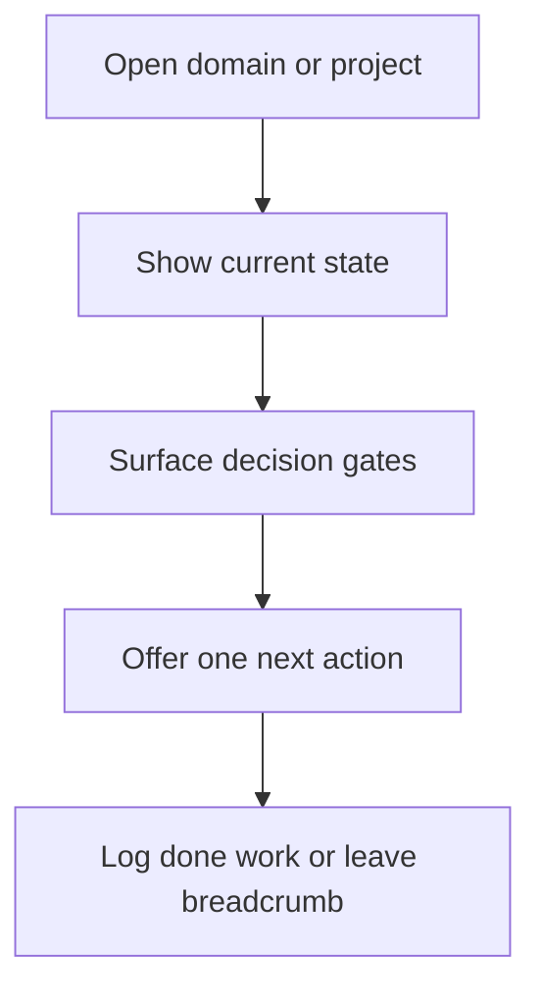
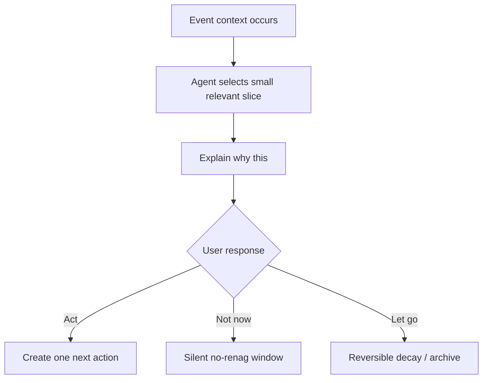
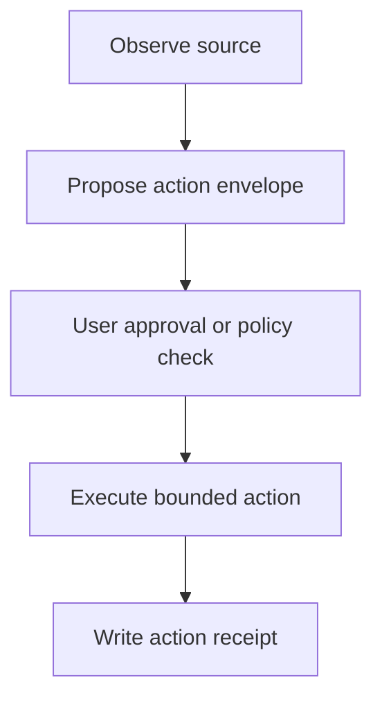

# Architecture map

## System shape

`life-os` is the umbrella planning layer and shared contract/policy layer. It does not own every artifact; it maps relationships between systems, keeps cross-system decisions visible, and defines how focused tools hand off context, provenance, permissions, and receipts.

## Layers

| Layer | Canonical? | Role |
|---|---:|---|
| Markdown files | Yes | Intent, decisions, domain maps, re-entry notes. |
| PKMS vault | Yes, for knowledge | Research, evergreen notes, project knowledge. |
| content-hoarder store | Yes, for saved items | Captured external content and triage state. |
| Indexes/search | No | Derived retrieval surfaces. |
| Dashboards | No | Curated views for orientation and action. |
| Agents | No | Structure, summarize, suggest, and transform through capability-gated actions. |
| Project registry | Yes, for project lifecycle | `/path/to/projects/PROJECTS.md` owns active/paused/done/reference status. |
| Documents source map | No | Folder-level map of personal sources; contents are read only for specific tasks. |
| SQLite ledgers | Module-dependent | Operational state for receipts, connector sync, capability grants, and derived indexes. |
| Research docs | No | Provenance for decisions; folded into ADRs before implementation. |

## Cross-system flows

### Capture

Capture ramps may include a new tab extension, `Win + N` AutoHotkey shortcut, Android PWA/share target, Google Keep, Discord bot, email-in, content-hoarder promotion, or Obsidian note. Per Decision 0003, these are many ramps into one inbox contract, not separate filing systems.

The research added one important constraint: capture needs a provenance envelope, not just text. Each capture should preserve source account, source app/device, raw reference, and enough context to later answer `Why this?`.

### Planning

Planning should behave like logistics, not a moral backlog: collect loose commitments, cross-dock them into the right shelf, expose only a finite slice, and let stale work be reheated, released, or paused.

### Resurfacing

A future today surface should open to one recommended action plus a few optional alternates, not a dashboard. Ranking inputs may include urgency, ease, importance, freshness, novelty, cost, confidence, and energy fit; every surfaced item needs a visible reason.

### Agent writes

Default agent posture is read-only or draft/propose. External writes, destructive actions, account changes, calendar writes, email sends, and money-adjacent operations require preview, explicit approval, scoped capability, and receipt.

## Initial project roles

| Project | Role in life-os |
|---|---|
| PKMS | Durable knowledge, research provenance, evergreen notes, project knowledge. |
| content-hoarder | Fast capture and triage for external content; decay/resurfacing proving ground. |
| life-os | Umbrella architecture, domain planning, cross-system decisions, re-entry notes. |
| adhd-design-language | Shared behavioral constraints and design rules. |
| Email commitments | Future module for extracting reply obligations and promises from email while preserving source account/thread evidence. |
| Calendar ops | Future execution-time module for events, prep, follow-up, buffers, and approved time-block proposals. |
| Finance ops | Future module over spreadsheets first; APIs/connectors later and safety-gated. |
| Travel ops | Future module over itinerary/event candidates; scraped events enter as review candidates, never automatic calendar writes. |

## Current architecture decisions

| Decision | Status | Summary |
|---|---|---|
| `0001` | Accepted | Plain files are the source of truth. |
| `0002` | Accepted | Use lifecycle buckets from `/path/to/projects/PROJECTS.md`. |
| `0003` | Accepted | Many capture ramps, one inbox contract. |
| `0004` | Accepted | Classify note purpose after capture. |
| `0005` | Proposed | Separate durable account identities by control and purpose. |
| `0006` | Accepted | Source-map Documents; do not bulk-import. |
| `0007` | Accepted | Build modular ecosystem connected by shared contracts. |
| `0008` | Accepted | Use Markdown for human artifacts and SQLite for operational ledgers. |
| `0009` | Accepted | Gate agent actions by capability, preview, approval, and receipt. |
| `0010` | Accepted | Use a standards-first UI stack until complexity earns a framework. |
| `0011` | Proposed | First implementation slice is one traceable email commitment card. |
| `0012` | Accepted | Use a private canonical repo with an optional sanitized public mirror. |
| `0013` | Accepted | Use content-hoarder as the first standard interface testbed. |

## Open architecture questions

- Which capture ramp should be prototyped first?
- Which files belong in the public-safe mirror allowlist?
- What exact read-only content-hoarder interface fields become v0?
- What user-controlled Developer/AI email identity should replace institution-controlled ownership?
- Which data should stay only in PKMS versus be summarized here?
- What agent commands are needed for re-entry, capture shaping, and decision surfacing?
