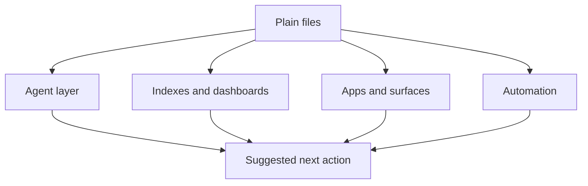

# life-os charter

## Mission

Create a plain-file operating layer for the owner's life systems: projects, knowledge, captures, commitments, maintenance loops, and re-entry paths.

The system should help with orientation and starting, not produce a larger pile of obligations.

## Non-goals

- Replace PKMS as the knowledge vault.
- Replace content-hoarder as the save/triage app.
- Build a monolithic everything app.
- Force perfect taxonomy before use.
- Track raw backlog debt, streaks, or synthetic overdue pressure.

## Architecture stance

Plain Markdown files are canonical. Everything else is derived:

## Operating principles

- Capture should be faster than deciding where something belongs.
- Structure should emerge from observed use.
- Re-entry is a first-class design target.
- Tasks can expire or pause; knowledge can persist and resurface.
- One visible next action is more useful than a complete project breakdown.
- The system should get simpler in low-energy states.

## Immediate scope

This project starts by mapping the architecture around:

- PKMS
- content-hoarder
- life domains
- capture and resurfacing flows
- agent-mediated planning
