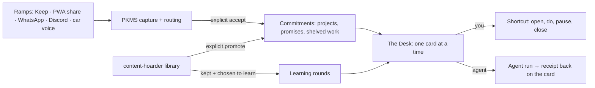

# Khaos modules: desk, closure, decisions, learning, car (proposal, 2026-11-01)

Status: proposal for the owner to align on. Nothing here is built unless marked ✅.

Binding decisions it follows:
- 0016: attention budget, default 0.
- 0017: every card carries a reason.
- 0023: re-entry without counts.
- 0025: one card per primary surface; overviews only when deliberately opened.
- 0035: engagement mechanics are chosen, switchable and measured.

Inputs:
- `research-takeaways.md` (Pass 01 learning, Pass 05 car).
- `PKMS/vault/resources/research/2026-10-20-duolingo-engagement-design.md`.
- `content-hoarder/docs/design/hooks.md`.
- An external advisory (Astra, 2026-11-01). It is context, not a decision.

## Shape: one desk, many ramps

Saving never creates a duty. Something becomes a commitment only when the owner accepts it on a card.
This keeps the library (content-hoarder, PKMS) separate from the commitment ledger.

## Module 1 — The Desk (dashboard + closure)

**Job:** "What deserves my attention now, and what can I safely put down?"

**Primary surface:** one card, desktop- and phone-sized, reusing the content-hoarder round
(keyboard-first, swipe on phone, undo). Every card shows:
- what it is (a project, promise or shelved agent session) and its source;
- the last confirmed state and the one open blocker;
- one proposed next step;
- the reason it is here (0017).

| Key | Action | Deterministic? |
|---|---|---|
| `Enter` | **Resume**: open the source (repo, note, chat) at the recorded spot | Yes |
| `D` | **Done**: mark finished, with a one-line receipt | Yes |
| `S` | **Shrink**: write a smaller honest finish, keep the rest as notes | Yes |
| `P` | **Pause until…**: a date or a condition ("when the friend replies") | Yes |
| `C` | **Close**: stop it. Shows what is still owed to others first; never cancels an external promise by itself | Yes, with a check |
| `G` | **Give to an agent**: build a bounded work request; the result returns to this card as a receipt | Manual handoff first, labelled as manual |

**The overview from the screenshot** ("Welcome back", today's activities, progress tiles, calendar,
lesson list) is allowed only as a view you open on purpose (0025). It is not the home screen.

| Screenshot element | Khaos version |
|---|---|
| "Welcome back 👋" | The 0023 re-entry line: past wins, one card, a one-tap amnesty; no "you were away N days" |
| "Your activities today (5)" | At most 3 cards chosen for today (the 0025 "show 3" expansion), each with its reason |
| Progress tiles (Completed / Score / Active) | Wins only: cleared, kept, learned, closed. No "remaining" tile |
| Calendar | Streak days with freezes (0035), switchable; later, calendar ops |
| Lesson list | The learning queue (module 3), capped and opt-in |

**Keep it away from Notion:**
- no user-built databases, views or properties;
- one fixed card anatomy;
- at most 3 cards in the overview;
- every module must earn its place.

**Smallest test:** one real shelved project per tester (for example a dropped agent session).
1. Paste the excerpt; the card shows its state, blocker and next step.
2. The tester picks Resume, Pause, Close or Give.
3. A day later, check: did they come back to the card, or rebuild the context by hand?

Compare against their own notes and against a plain Markdown note with the same fields.

**Gaps before building:**
- A stable project ID. Task-line hashes change when a line is edited.
- Who accepted which commitment, and when.
- A dispatch lifecycle: pending, failed and cancelled states, plus links to the outputs.
- "The agent says done" must not mark the commitment done until the owner confirms.

## Module 2 — Decision support (batch + outcomes)

**Job:** decide a batch of similar things fast. Examples: 25 saved cards, 5 shelved projects, a
week's captures.

**Flow:**
1. A model proposes a decision and a one-line reason for each card.
2. The owner accepts card by card, or "accept all the confident ones".
3. Every proposal and every override is logged.

The acceptance rate per type tells us whether the model is worth its cost.

**Rules:**
- The model is optional, and the owner picks it: local/self-hosted, or a hosted lane the owner configures.
- When no model is available, the round still works with rules and keyboard shortcuts.
- Nothing is applied without the owner's acceptance.

**Already in the code:** content-hoarder `suggest` (local LLM), `learn-triage` (a transparent
model) and `assist-auto-archive`.

**Smallest test:** run on one 25-card round. Compare time and undo rate across three setups:
rules only, a plain assistant prompt, and this flow.

## Module 3 — Learning (from what you chose to keep)

**Job:** actually remember the few things you decided were worth keeping.

**Flow:**
1. On a kept item, tap "Learn this". Opt-in per item, never automatic.
2. It drafts 3 questions tied to the source. The owner approves or edits them before they enter the deck (Pass 01: human approval and per-card provenance).
3. Reviews run as a normal finite round: Got it / Again / Let go.
4. Scheduling uses FSRS, which recalibrates after a gap instead of building a debt (Pass 01).

**Limits:**
- The visible queue never goes above 10.
- No due count is shown.
- The daily budget defaults to 0 until the owner turns it on (0016).

**Streak conflict:** Pass 01 says "SR without streaks"; 0035 lets the owner choose. The learning
streak is off by default.

**Prior art:**
- Readwise Daily Review ("resurfaces the right highlight at the right time").
- Recall ("Quiz and spaced repetition to reinforce long-term memory").

The difference here: questions come only from items the owner chose, and "Let go" is a first-class answer.

**Smallest test:**
- 5 kept items, 3 questions each, one review a week later.
- Falsified if the owner prefers rereading, or if the questions mislead.

## Module 4 — Car (capture first)

**Job:** don't lose a thought while driving.

**Rules (Pass 05):**
- Single-turn only: speak → "Saved". No filing in the car.
- Assume the voice transits Google.
- `car_access: false` for health, finance, accounts and journal content.

| Step | What | Builds on | Status |
|---|---|---|---|
| v0 | "Hey Google, add a note to Keep: …" while parked → PKMS Keep ramp → day note within one tick | PKMS Keep ingest on the VPS (recorded working Oct 2026) | Needs one parked test with timing; no code |
| v0b | "Send a WhatsApp to myself: …" → wacli ramp | PKMS WhatsApp ramp | Same parked test |
| v1 | Read-only voice query ("what's my one next thing?") via the Discord bot or an App Action, answered in one sentence | PKMS `!today` | Proposal; needs the P2 voice query contract |
| later | An Android Auto messaging-style app, or an open client | — | Only if v0/v1 show a gap; not CarPlay, Android Auto and a custom client at once |

## Engagement across modules

One shared set of mechanics (sound, XP, streak with freezes, quests, gem) and one events ledger.
Not one per module. Each module spends from the 0016 attention budget, so cards never pile up across
surfaces.

## Order

1. Speed and reliability of the existing round (content-hoarder device pass). This is the reason the owner stopped using it.
2. The Desk test with one shelved project per tester (manual handoff for "Give to an agent").
3. Car v0, parked: no code, one timing check.
4. Decision support on one round.
5. Learning, once kept items exist in numbers.
