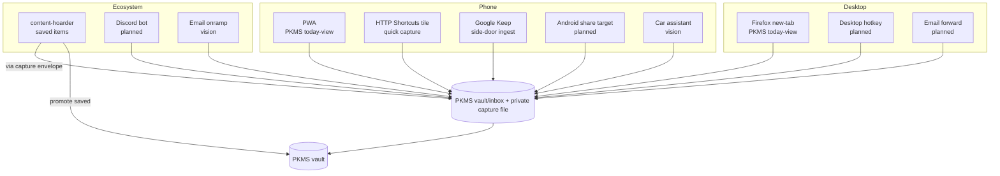

# Onramps

Status: living map of capture ramps into PKMS and the broader ecosystem. Update as ramps are added, changed, or paused.

This doc consolidates the onramp picture across PKMS, content-hoarder, life-os, and the vision-stage ramps. It is descriptive, not a plan — current and near-term ramps are listed by status; vision-stage ramps are listed separately.

## Onramp contract

Every onramp must obey Decision 0003's one-inbox contract:

1. Append-only capture.
2. No required tags, project choice, priority, or due date at capture time.
3. Preserve source/context metadata when available (the `capture` envelope in `docs/contracts.md`).
4. Route into a single shaping queue before anything becomes canonical knowledge or work (Decision 0004: classify after capture).
5. Confirm save immediately.

The `capture` contract fields (per `docs/contracts.md`): `id`, `captured_at`, `source`, `source_account_id`, `raw_text`, `raw_ref`, `context.{device,app}`. New ramps should emit this envelope.

## Map

Solid = exists. Dashed/labeled = planned or vision-stage.

## Current ramps (implemented)

| Ramp | Surface | Destination | Status | Source |
|---|---|---|---|---|
| Firefox new-tab | Desktop ambient briefing | PKMS `vault/inbox/` | Implemented | PKMS docs (private) |
| Phone PWA | Phone home-screen standalone | PKMS `vault/inbox/` | Implemented; off until the new phone path lands | PKMS docs (private) |
| Phone capture tile | HTTP Shortcuts QS tile | PKMS `vault/inbox/` | Implemented; off until the new phone path lands | PKMS docs (private) |
| Google Keep ingest | Keep notes side-door | PKMS `vault/inbox/` (images OCR'd) | Live | PKMS docs (private) |
| content-hoarder save | Browser/app save action | content-hoarder store | Live | content-hoarder repo |
| Workspace capture file | Manual Markdown edit | private workspace inbox | Live (fallback) | Decision 0003 |

"Live" means reachable in the current deployment. The phone surfaces are built and were proven on-device earlier; they stay off until the new phone path lands, so the roadmap treats the PWA share target as the next on-device proof.

## Planned ramps (decided, not yet built)

| Ramp | Surface | Destination | Source |
|---|---|---|---|
| Desktop capture hotkey (Hyprland bind; was `Win + N` AutoHotkey on Windows) | Desktop hotkey | PKMS `vault/inbox/` | Decision 0003 |
| Android share target | Phone share sheet | PKMS `vault/inbox/` | Decision 0003 |
| Discord bot | Personal server + bot | PKMS `vault/inbox/` | Decision 0003 |
| Email onramp to PKMS | Email forward/send | PKMS ingestion + routing | Private concept note |
| Obsidian note | Obsidian capture | PKMS (as PKMS matures) | Decision 0003 — migrate from legacy `obsidian_notes/` |

## Vision-stage ramps (not committed)

| Ramp | Surface | Source |
|---|---|---|
| Car assistant (Android Auto / Google Assistant / Gemini) | Voice capture + voice query | Private concept note |

## content-hoarder ↔ PKMS integration

**Honest note:** the integration picture below is assembled from Decision 0004, `docs/contracts.md`, the domain briefs, and the owner's 2026-07-04 thinking. The assistant review that was consulted did not address the content-hoarder/PKMS handoff directly, so the design work here is first-hand.

### Current rule (Decision 0004)

Decision 0004 already governs the handoff:

| Content class | Default fate | Canonical home |
|---|---|---|
| Meme/funny | Preserve/search-only or decay | content-hoarder |
| Interesting reading link | Save/triage; may become PKMS knowledge | content-hoarder, then PKMS if promoted |
| Reference/research | Persist and resurface by relevance | PKMS |

The promotion path is: content-hoarder triages → items marked for promotion → PKMS ingests as knowledge. Today this is a manual promotion (`pkms promote …` exists; life-os fixtures do not yet).

### Owner's 2026-07-04 sharpening

> When items are marked as Saved by content-hoarder, send it to PKMS. content-hoarder can unsave the content on reddit/HN/youtube respectively.

This is a sharper rule than Decision 0004's "may become PKMS knowledge if promoted":

- **Save in content-hoarder → ingest into PKMS.** The Save action becomes the promotion trigger, not a separate triage step. This collapses two states (saved + promoted) into one (saved = promoted).
- **Unsave on the source platform.** After PKMS ingests, content-hoarder unsaves the item on Reddit/HN/YouTube. The source platform's "saved" list is no longer the canonical store — PKMS is. This keeps Watch Later / Saved lists from filling up.

### Tensions this creates

- **Loss of triage.** Decision 0004's "save/triage; may become PKMS knowledge if promoted" lets content-hoarder triage *before* PKMS ingests. Auto-promote on Save skips triage — PKMS gets everything saved, including low-value items. The design language's no-immortal-pile rule (§4) may be violated if Save becomes a guilt-free path into PKMS.
- **Save semantics differ by platform.** Reddit Save, HN upvote/save, YouTube Watch Later / Save — these mean different things. Auto-unsave on all of them changes the source-platform UX in ways the user may not want (e.g., losing a Watch Later item the user wanted to watch *and* keep).
- **Reversibility.** Unsave on the source platform may be irreversible (YouTube removes Watch Later entries cleanly; Reddit Save toggles cleanly; HN has no native "save" — it's upvotes/flags). A receipt and a re-save path are needed.
- **Provenance.** When PKMS ingests from content-hoarder, the `source_span` should point to the content-hoarder item (which itself points to the original URL). Two-hop provenance.

### Decision gate

This is a real decision, not a polish. Three options:

| Option | Behavior | Pros | Cons |
|---|---|---|---|
| A — Status quo (Decision 0004) | Save in content-hoarder; promote to PKMS manually | Triage gate preserved; PKMS stays clean | Two-step; relies on manual promotion |
| B — the owner's 2026-07-04 sharpening | Save in content-hoarder → auto-ingest to PKMS → unsave on source | One step; source lists stay clean; PKMS is canonical | No triage gate; PKMS gets everything saved; unsave reversibility |
| C — Hybrid | Save in content-hoarder → triage sprint → promote → unsave on source | Triage gate preserved; source lists still get cleaned | Two-step again; triage sprint must actually run |

**Resolved 2026-07-20 → the promotion decision recorded in the private canonical repo (Proposed): Option C — hybrid.** Save stays save; promotion via triage sprint on resurface cards (fixture-proven); unsave-on-source deferred behind `action_receipt` infra. Do not implement Option B's auto-promote/auto-unsave.

### Google Keep standalone-link pile-up

The owner (2026-07-04): Google Keep has an existing onramp with PKMS. Lately, standalone YouTube links have been saved in Keep because Watch Later playlists are full. This needs to be dealt with.

This is a symptom of the same root issue: YouTube Watch Later is full → overflow goes to Keep → Keep accumulates standalone links that aren't really "notes." Two paths:

1. **Treat Keep as a pure capture ramp, not a store.** Keep notes flow into PKMS via the existing ingest; Keep is not where links live. The Keep ingest already does this — `pkms ingest keep` pulls new notes into `vault/inbox/`. The fix is to let Keep be a transient ramp: links go in, get ingested, then are archived/deleted from Keep.
2. **Route YouTube links to content-hoarder, not Keep.** If content-hoarder is the canonical store for saved external content (per Decision 0004), YouTube links belong there, not in Keep. The Keep ramp is for *notes*, not links.

**Resolved 2026-07-20 (same decision, §Decision.4): option 2.** YouTube and other standalone content links route to content-hoarder; Keep stays a notes-only capture ramp.

## Integration with the project map

The onramp picture cuts across the capture arm and the existing-systems layer of the private project map. This doc is the detailed view; the project map is the summary.

## Active next action

⏱ Size: M

▶ Next action: Write the PKMS promotion-ingest spec (destination `vault/inbox/`, envelope mapping, two-hop `source_span`) per the private promotion decision.

✓ Done when: A promoted content-hoarder item lands in PKMS `vault/inbox/` with a valid capture envelope and an action_receipt on the CH side.

## Re-entry breadcrumb

Re-enter by reading §Onramp contract (the rules every ramp obeys), §Map (where ramps stand), and §content-hoarder ↔ PKMS integration (direction now recorded in the private promotion decision — hybrid promote, Keep notes-only). PKMS onramp docs live in the private workspace; this doc is the life-os-side integration view.
